# Wakeel Desk: case management for law firms in Pakistan

A subscription web app for advocates and law firms, built for Karachi first and then other Pakistani cities. It runs the whole chambers in one place: cases, court dates, files, junior lawyers, fees, and a drafting assistant that prepares pleadings in the format Pakistani courts expect. Clients follow their case from their phone.

**Source code is private.** This page shows the product. To see it running, [get in touch](#contact) for a live demo.

## Three apps in one product

### 1. The lawyers' app
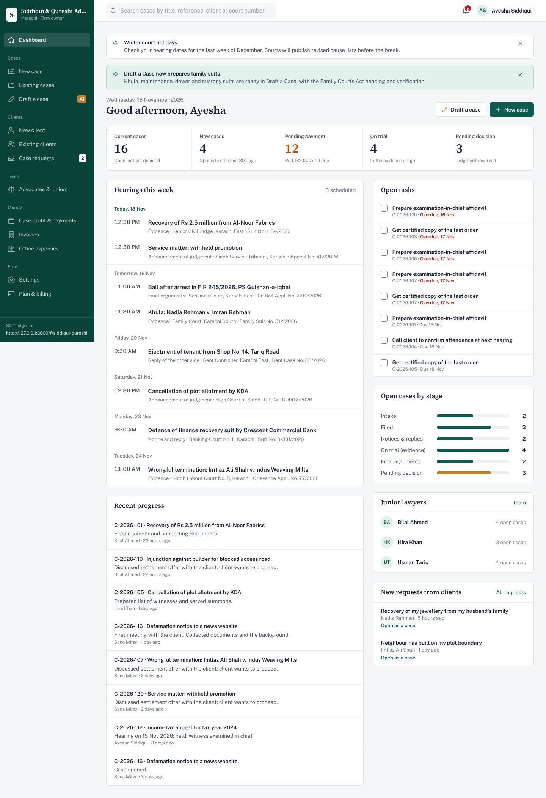

The dashboard answers the five questions a senior advocate asks every morning: how many cases are open, how many are new, how many still owe fees, how many are on trial and how many are waiting for judgment. Below it are this week's hearings, open tasks, each junior's workload and new requests from clients.

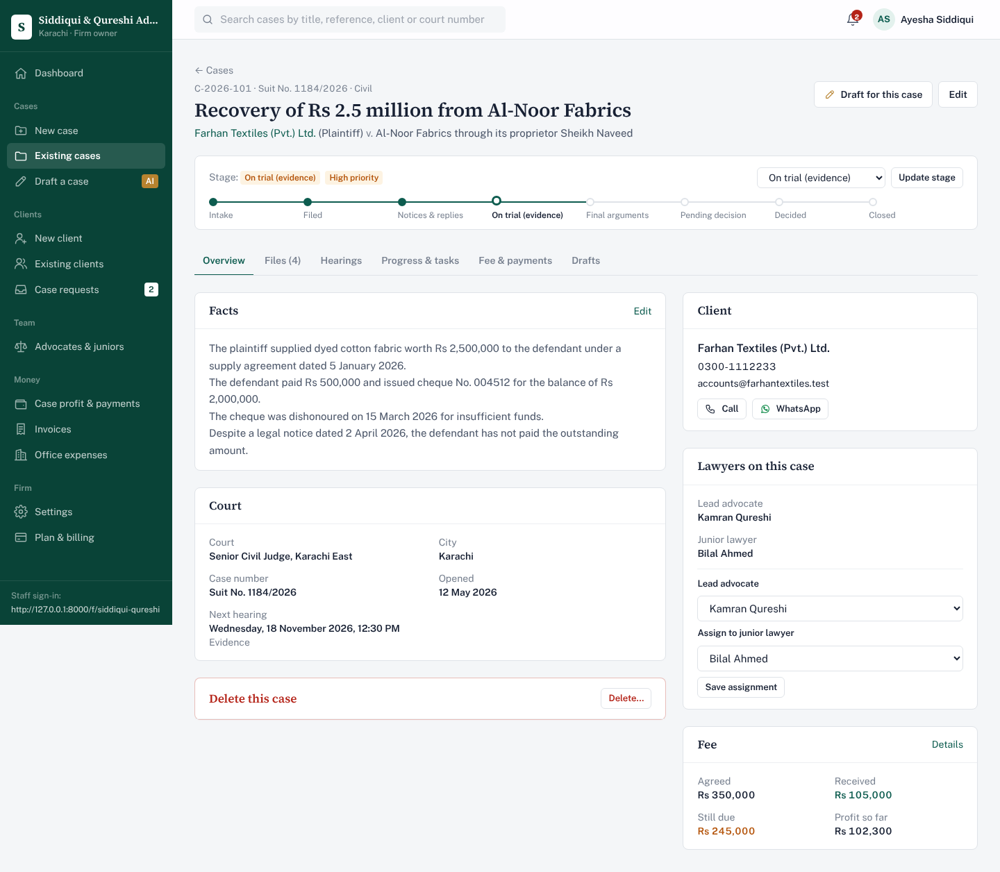

Every case shows where it stands, from intake to decision, with tabs for files, hearings, progress and tasks, fee and payments, and drafts.

| Case files | Hearings |
| --- | --- |
| 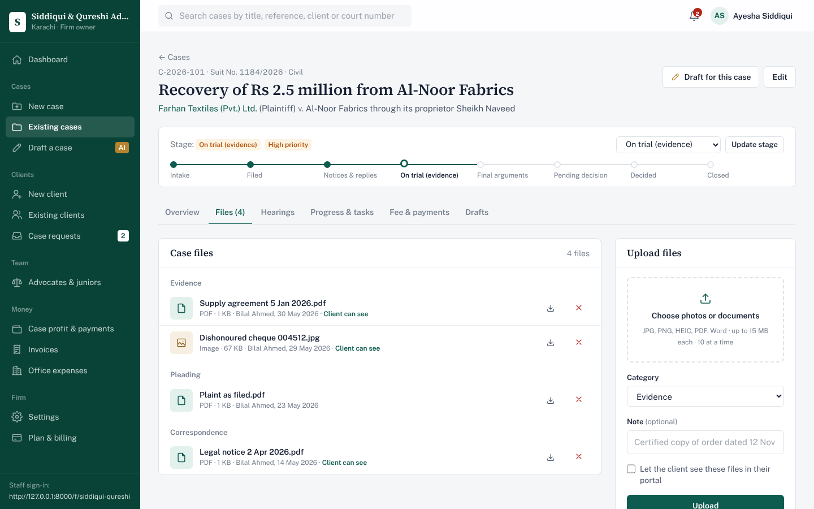 | 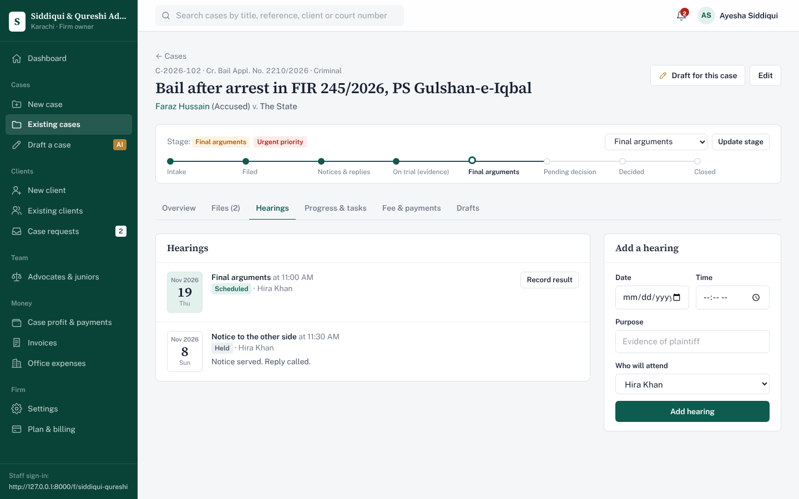 |

Upload photos of documents, PDFs and Word files. Record what happened at each hearing and fix the next date; the client gets a plain-language update automatically.

### Draft a Case
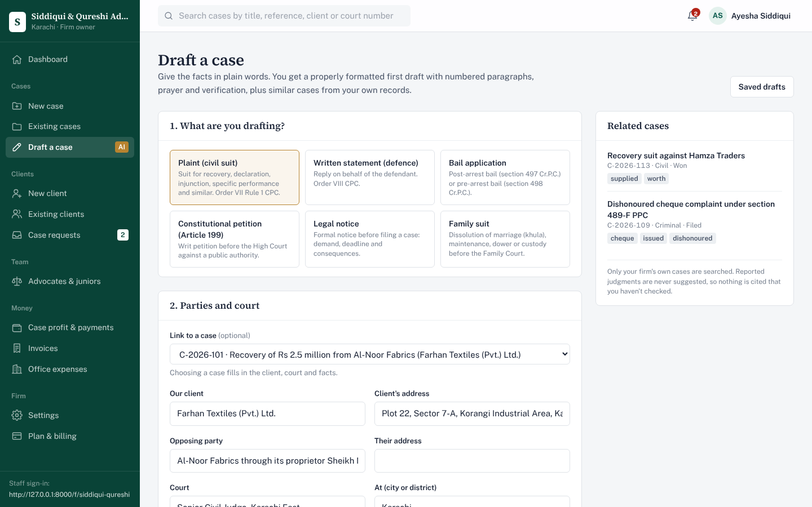

Pick the document (plaint, written statement, bail under s.497/498 Cr.P.C., Article 199 petition, legal notice or family suit), give the facts in plain words, and get a formatted first draft: court heading, parties, numbered "That…" paragraphs, prayer, signature and verification.

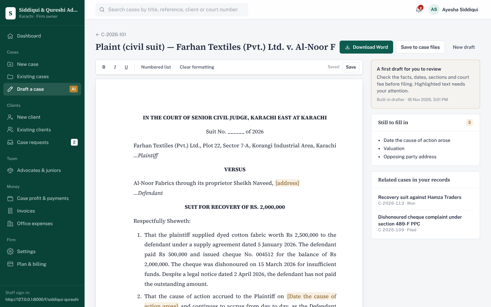

- Similar cases from the firm's own records appear while you type, so you can reuse what worked.
- It never invents case law. Any law-report citation (PLD, SCMR, CLC, YLR and others) is highlighted for the lawyer to verify.
- Missing details are left as highlighted blanks and listed.
- Edit in the browser, download as Word on legal-size paper, or save straight to the case files.
- Free built-in drafter, with optional AI polish capped per plan.

### Team and money
| Advocates and juniors | Case profit & payments |
| --- | --- |
| 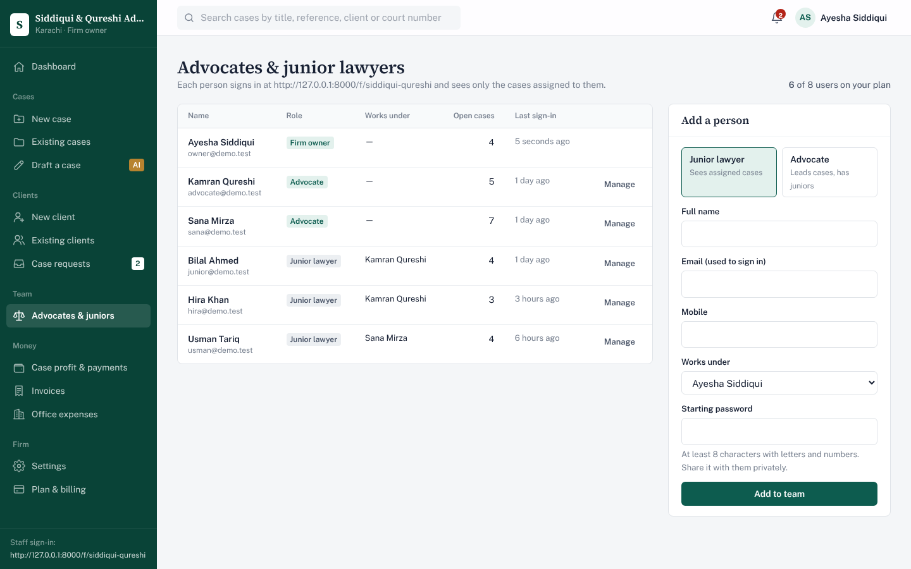 | 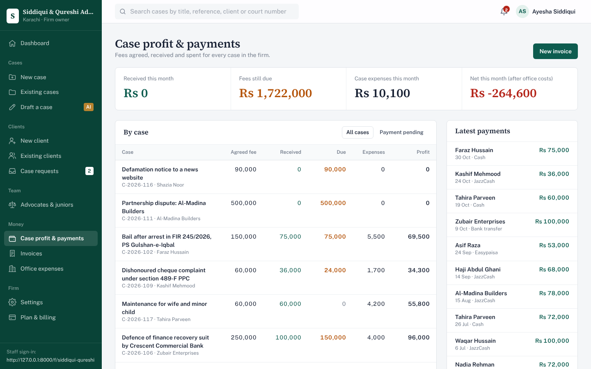 |

Each junior lawyer signs in at the firm's own link and sees only the cases assigned to them. Advocates see their own juniors and how their cases are going. Owners see fees agreed, received and still due, case expenses, invoices and office expenses.

### 2. The client portal (mobile)
| Sign in | Case progress |
| --- | --- |
| 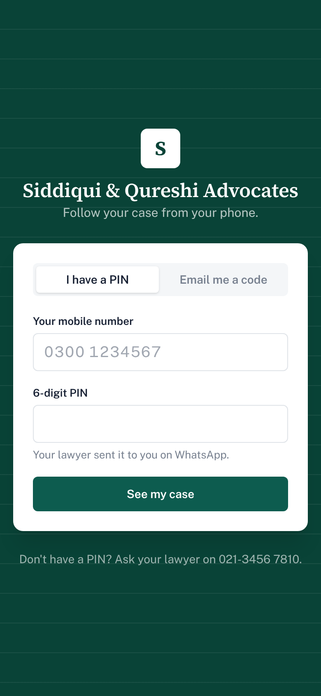 | 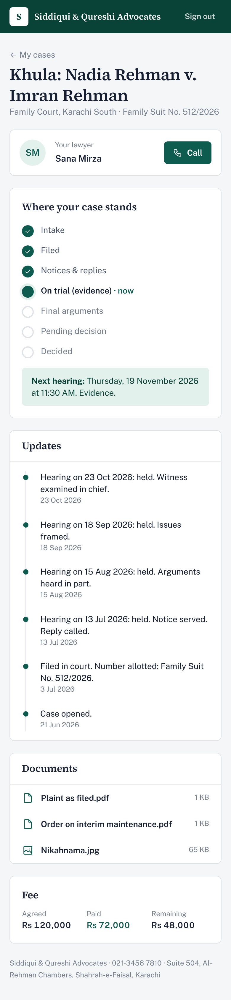 |

Clients sign in with their phone number and a PIN their lawyer sends on WhatsApp, or a code by email. No SMS costs. They see where their case stands, the next hearing, documents shared with them and the fee balance, can call their lawyer with one tap, and can file a new case request.

### 3. The owner console
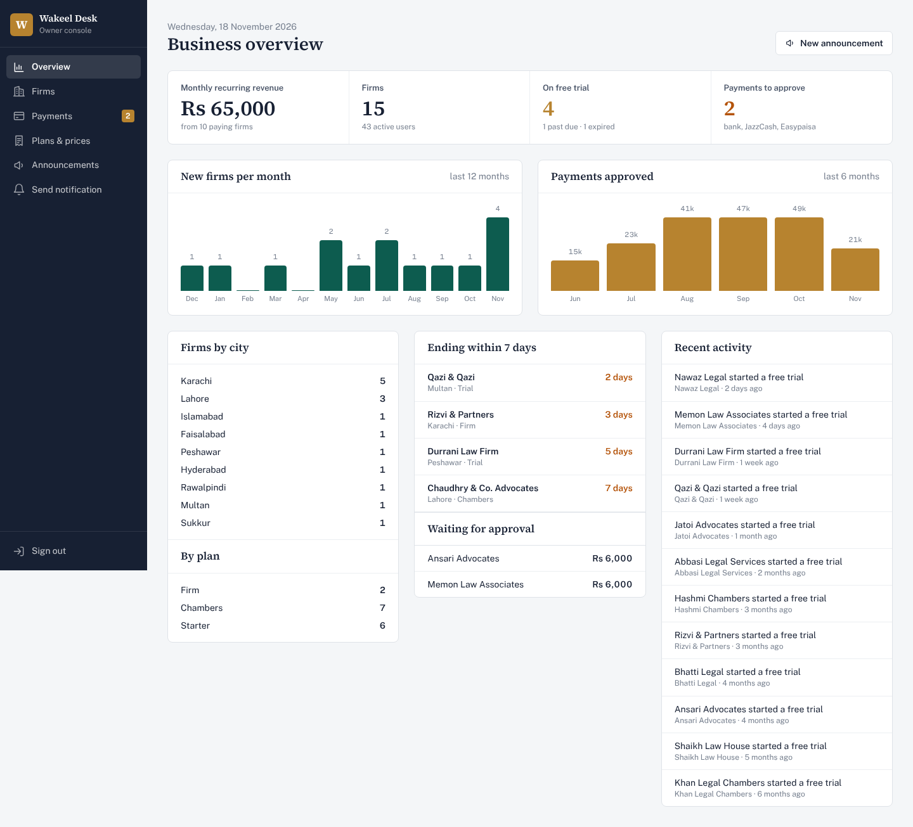

For running the subscription business: monthly recurring revenue, firms by status, city and plan, sign-ups per month, subscriptions ending this week, and payments to approve.

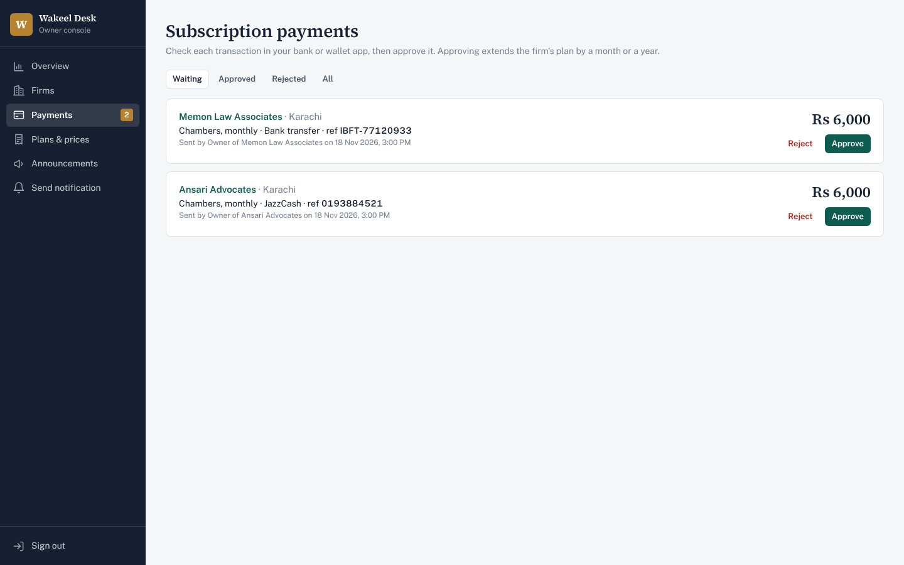

Firms pay by bank transfer, JazzCash or Easypaisa and submit the transaction ID. Approving it extends their plan automatically. The console also edits plans and prices, extends trials, suspends firms, publishes announcements by city or plan, and sends in-app notifications.

## How it's built

- **Multi-tenant SaaS**: one database for all firms, every record scoped to its firm. Automated tests confirm one firm can never open another's cases, files, clients, invoices or drafts.
- **Roles and permissions**: firm owner, advocate, junior lawyer and platform admin, each with their own view of cases and money.
- **Subscriptions**: 14-day free trial, monthly or yearly plans in PKR, user, storage and AI limits per plan, 3-day grace period, then read-only until renewal.
- **Private file storage**: documents are only served after a permission check.
- **Zero running cost to start**: no SMS gateway, no payment gateway fees, no paid AI required.
- **Stack**: Laravel 13, PHP 8.3, MySQL, Tailwind CSS, Alpine.js, PhpWord. Fully tested with PHPUnit.

## Contact

Built by **Muzamil**. Need a SaaS product, a practice management system or an AI drafting tool for your industry? Open an issue on this repo or reach out through my GitHub profile, [@muzamil258](https://github.com/muzamil258).

*All names, cases and figures in the screenshots are fictional.*
